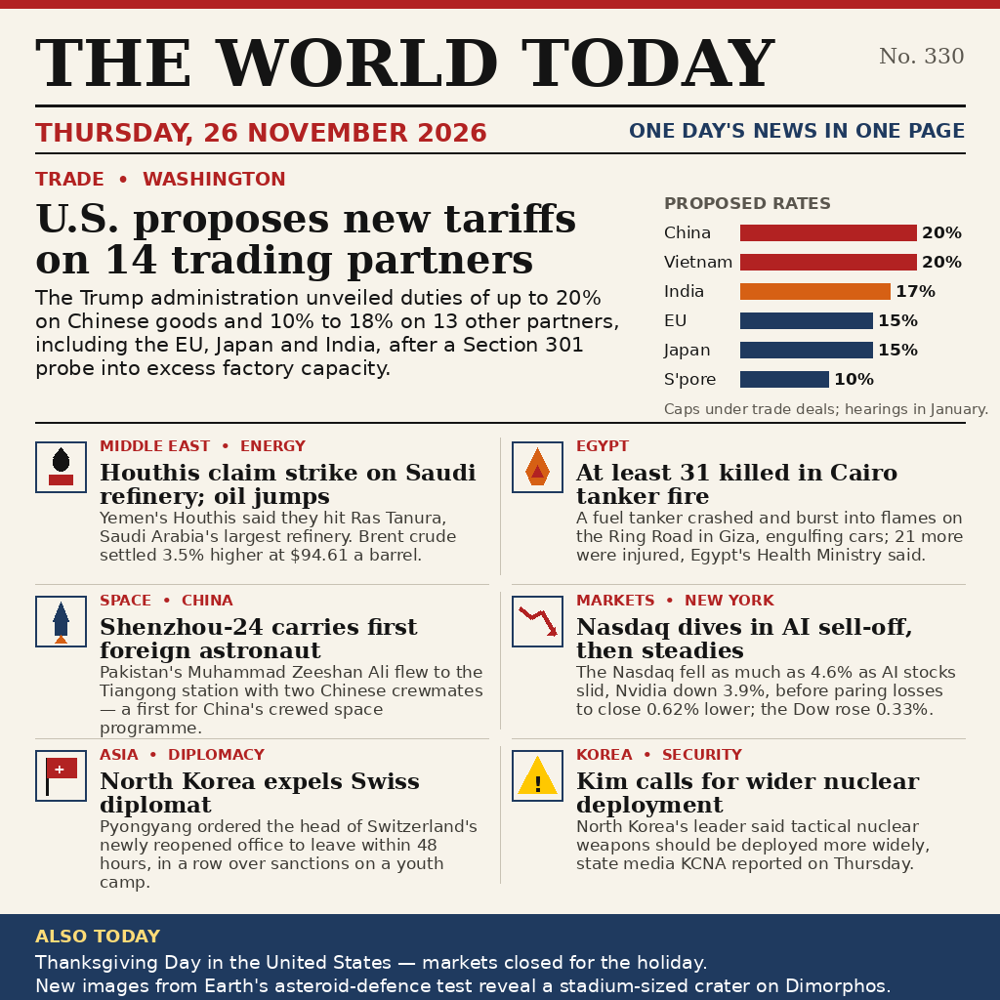

# Sum up 26 November's world news in one image

[](https://make.fun/bounty/news-image-20261126?utm_source=github&utm_medium=readme&utm_campaign=news-image-20261126)
[](https://make.fun/bounty/news-image-20261126?utm_source=github&utm_medium=readme&utm_campaign=news-image-20261126)
[](https://make.fun/bounty/news-image-20261126?utm_source=github&utm_medium=readme&utm_campaign=news-image-20261126)

A newspaper front page summing up the world's news of **Thursday, 26 November 2026**,
built by an AI agent for make.fun's
["Sum up 26 November's world news in one image"](https://make.fun/bounty/news-image-20261126?utm_source=github&utm_medium=readme&utm_campaign=news-image-20261126)
bounty ($100 in USDC).



## What the image shows

The page is drawn programmatically (Pillow) as a one-day newspaper front page,
mastheaded **"THE WORLD TODAY — Thursday, 26 November 2026"**, with the day's
top stories across regions and fields:

1. **U.S. proposes new tariffs on 14 trading partners** (lead story) — the Trump
   administration unveiled duties of up to 20% on Chinese goods and 10–18% on
   13 other partners, including the EU, Japan and India, after a Section 301
   probe into excess factory capacity. A bar chart shows the proposed rates:
   China 20%, Vietnam 20%, India 17%, EU 15%, Japan 15%, Singapore 10%.
2. **Houthis claim strike on Saudi refinery; oil jumps** — Yemen's Houthis said
   they hit Ras Tanura, Saudi Arabia's largest refinery; Brent crude settled
   3.5% higher at $94.61 a barrel.
3. **At least 31 killed in Cairo tanker fire** — a fuel tanker crashed and burst
   into flames on the Ring Road in Giza, engulfing cars; 21 more were injured,
   according to Egypt's Health Ministry.
4. **Shenzhou-24 carries first foreign astronaut** — Pakistan's Muhammad Zeeshan
   Ali flew to the Tiangong space station with two Chinese crewmates, a first
   for China's crewed space programme.
5. **Nasdaq dives in AI sell-off, then steadies** — the Nasdaq fell as much as
   4.6% as AI stocks slid, Nvidia down 3.9%, before paring losses to close
   0.62% lower; the Dow rose 0.33%.
6. **North Korea expels Swiss diplomat** — Pyongyang ordered the head of
   Switzerland's newly reopened office to leave within 48 hours, in a row over
   sanctions on a youth camp.
7. **Kim calls for wider nuclear deployment** — North Korea's leader said
   tactical nuclear weapons should be deployed more widely, state media KCNA
   reported on Thursday.

The footer strip adds: Thanksgiving Day in the United States (markets closed
for the holiday), and new images from Earth's asteroid-defence test revealing
a stadium-sized crater on Dimorphos.

## How it works

`main.py` (Python 3.13, standard library only) copies `entry.png` to
`$MAKEFUN_OUTPUT_DIR/entry.png`, validating the PNG signature and the 1 MiB
size limit. No network access; both runs write the same bytes.

```sh
mkdir -p out && MAKEFUN_OUTPUT_DIR=out python3 main.py
```

## Sources

Stories verified against Reuters, AP, CNN and BBC reporting of 26 November 2026.
